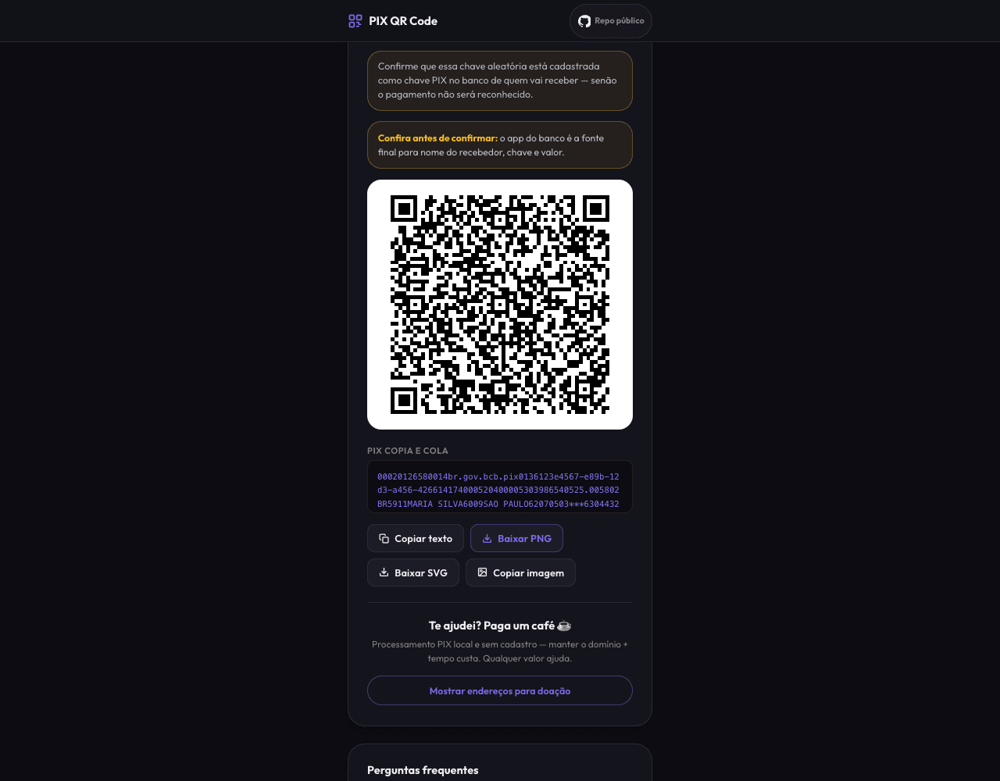
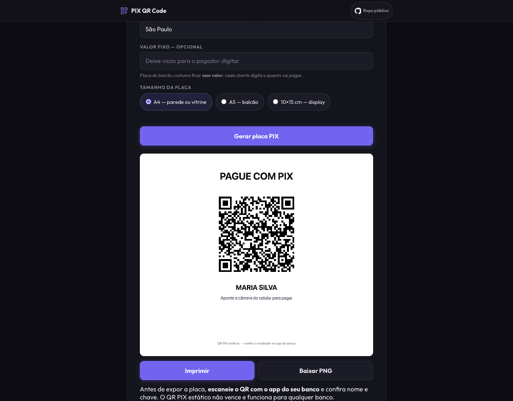

# pix2qr — gerar, ler e imprimir QR Code PIX no navegador

> Gere QR Codes PIX, decodifique um Copia e Cola e monte uma **placa PIX para
> imprimir** — tudo 100% no navegador, **sem cadastro e sem backend de
> pagamentos**. Funciona offline e instala como PWA.

**Use agora: [pix2qr.xyz](https://pix2qr.xyz)** · [Placa PIX para imprimir](https://pix2qr.xyz/qr-code-pix-para-imprimir)

[](LICENSE)
[](https://github.com/ZaMpAdAKiNg/pix2qr/actions/workflows/guardrails.yml)

| Gerar e copiar | Placa pronta para imprimir |
| --- | --- |
|  |  |

## O que ele faz

- **Gera QR Code PIX** a partir da chave: CPF, CNPJ (inclusive o novo formato
  alfanumérico), e-mail, telefone ou chave aleatória — com validação dos dígitos
  verificadores oficiais.
- **Lê e decodifica** um QR Code PIX existente (upload de imagem ou foto) e o
  converte em Copia e Cola.
- **Resume o pagamento** ao colar um Copia e Cola: valor, recebedor e cidade,
  distinguindo QR estático de dinâmico e os cenários de Pix Automático — com
  validação do CRC16.
- **Monta a placa PIX imprimível** em A4, A5 ou 10×15 cm: imprimir direto do
  navegador ou baixar em PNG. Ideal para balcão, vitrine e delivery.
- **Valor opcional** com formatação brasileira (`R$ 1.234,56`).
- **Funciona offline** depois do primeiro acesso (Service Worker) e **instala
  como app** (PWA).

## Por que 100% no navegador

Todo o conteúdo PIX é processado em JavaScript no seu dispositivo. Isso é
verificável: o código é aberto, e você pode **ativar o modo avião e continuar
gerando QR Codes** — nenhum gerador com backend consegue isso.

**O que o pix2qr faz:** gera e decodifica BR Code localmente, valida chave e CRC
segundo as especificações públicas do Banco Central e da EMVCo.

**O que ele não faz:** não inicia, intermedeia nem garante pagamentos; não
consulta o DICT online; não envia chave, valor, nome, cidade, payload ou imagem
para servidor algum; não guarda seus dados.

Existe telemetria técnica de acesso (Umami), com eventos que não incluem nenhum
dado do pagamento — detalhes e limites conhecidos em [PRIVACY.md](PRIVACY.md).

## Aviso importante

O pix2qr é uma ferramenta independente: não é banco, PSP nem serviço do Banco
Central, e não é oficial, afiliado ou endossado por essas instituições. Ele
apenas gera e exibe dados localmente. Antes de confirmar qualquer pagamento,
**confira o nome do recebedor, a chave e o valor no app do seu banco**. O site e
o código são fornecidos como estão, sem garantias; o projeto não se
responsabiliza por dados incorretos informados pelo usuário nem por pagamentos
enviados ao destinatário errado.

## Base normativa

As validações seguem as especificações públicas:
[API DICT 2.12.0](https://www.bcb.gov.br/content/estabilidadefinanceira/pix/API-DICT.html),
[DV do CNPJ alfanumérico (Receita Federal)](https://www.gov.br/receitafederal/pt-br/centrais-de-conteudo/publicacoes/documentos-tecnicos/cnpj),
[Manual de Padrões para Iniciação do Pix](https://www.bcb.gov.br/content/estabilidadefinanceira/pix/Regulamento_Pix/II_ManualdePadroesparaIniciacaodoPix.pdf),
[Manual do BR Code](https://www.bcb.gov.br/content/estabilidadefinanceira/spb_docs/ManualBRCode.pdf)
e [EMV Merchant-Presented QR](https://www.emvco.com/emv-technologies/qr-codes/).
Isso não constitui homologação nem certificação regulatória.

## Rodar localmente

É um site estático — qualquer servidor HTTP serve:

```bash
git clone https://github.com/ZaMpAdAKiNg/pix2qr.git
cd pix2qr
python3 -m http.server 8000      # ou: npx serve .
```

O núcleo PIX tem testes sem dependências (`node --test test/*.test.js`); a
bateria completa de gates e o build com allowlist estão descritos em
[CONTRIBUTING.md](CONTRIBUTING.md). Ao testar mudanças localmente, limpe o
Service Worker (DevTools → Application → Unregister + Clear storage).

## Arquitetura

- **HTML/CSS/JS vanilla** — zero framework, sem bundler.
- [`pix-core.js`](pix-core.js) — núcleo puro e testável: CRC16, TLV (EMV-MPM),
  parsing de chave e de Copia e Cola.
- [`app.js`](app.js) — camada de UI; [`sw.js`](sw.js) — Service Worker com shell
  versionado e atômico (a versão anterior segue funcional offline se o update falhar).
- [`analytics-privacy.js`](analytics-privacy.js) — redação de dados first-party
  antes do Umami.
- Libs vendadas (jsQR, node-qrcode) — ver [THIRD_PARTY.md](THIRD_PARTY.md).
- Deploy estático na Vercel com CSP estrita e headers de hardening.

## Contribuindo

PRs são bem-vindos — leia [CONTRIBUTING.md](CONTRIBUTING.md) (fluxo, gates de CI
e política de CHANGELOG) e [SECURITY.md](SECURITY.md) para reportar
vulnerabilidades.

**Regra de ouro (app financeiro):** nunca exibir nem gerar um valor/chave que
possa estar errado. Entrada ambígua vira erro explícito, nunca um número coagido
silenciosamente.

## Licença

[MIT](LICENSE).
